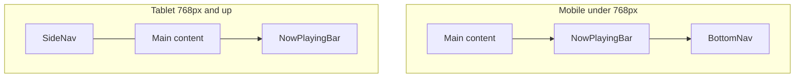

# Design — Mobile & Tablet Layout

Casa is a Home Assistant dashboard built for phones and tablets. This document is the layout contract: shell chrome, breakpoints, page primitives, motion, and per-route grids as implemented today.

There is no separate desktop layout. Wide viewports are tablet tiers (`lg` labelled sidebar, `xl` Rooms list-detail).

---

## Principles

1. **Phone = single column + bottom chrome.** Primary nav is a fixed bottom tab bar. Content stacks vertically; bottom padding clears the tab bar and safe area.
2. **Tablet = side chrome + denser grids.** Primary nav is a fixed left SideNav. Content uses more columns once there is room.
3. **Content follows available width, not viewport.** Most page grids use container queries (`@xl:`, `@2xl:`, …) on `Page` (or nested `@container` wrappers) so columns adapt beside the sidebar or inside Rooms list-detail.
4. **Shell uses viewport breakpoints.** Nav switch, sidebar width, and main offsets use `md` / `lg` / `xl` on the viewport.
5. **Limit horizontal scrolling.** The page shell and route layouts must not introduce document-level sideways scroll. Prefer wrapping, truncation, or shrinking so content stays within the available width. Intentional, contained strips (e.g. Home Scenes edge-bleed) are fine when they scroll *inside* a bounded row—not when they widen the viewport.
6. **Motion is one language.** Route changes, section entrances, presses, and layout morphs all share the same easing, durations, and springs from [`src/lib/motion.ts`](src/lib/motion.ts) and CSS tokens in [`styles.css`](src/styles.css). Prefer presets over one-off values.

---

## Breakpoints

Tailwind v4 defaults. No custom `--breakpoint-*` overrides.

| Prefix | Width | Owns |
|--------|-------|------|
| `sm` | ≥640px | Slightly wider page padding; SceneStrip stops edge-bleed |
| `md` | ≥768px | **Mobile → tablet nav switch**; SideNav appears; BottomNav hides |
| `lg` | ≥1024px | SideNav expands to labelled sidebar; larger horizontal padding |
| `xl` | ≥1280px | **Rooms list-detail only** (viewport + `matchMedia`) |
| `2xl` | ≥1536px | Rare as viewport; `@2xl:` is common as a **container** query |

Container query prefixes (`@md`, `@lg`, `@xl`, `@2xl`, `@3xl`, `@5xl`) use the same scale relative to the container, not the viewport.

**Rule of thumb:** shell chrome → viewport (`md:`, `lg:`, `xl:`). Page grids → container (`@xl:`, `@2xl:`). Exception: Rooms master list uses viewport `xl:`.

---

## Shell chrome

### Shared

| Constant | Value | Where |
|----------|-------|--------|
| Content max width | `80rem` | `AppShell` main |
| Page horizontal padding | `px-page` → `sm:px-6` → `md:px-8` → `lg:px-10` | `AppShell` main |
| Top padding | `pt-4` → `md:pt-8` | `AppShell` main |
| Primary nav items | Home, Rooms, Climate, Music, Security | `navItems.ts` |
| Settings | SideNav footer only (not in BottomNav) | `SideNav` |

Key files: [`AppShell.tsx`](src/components/layout/AppShell.tsx), [`SideNav.tsx`](src/components/layout/SideNav.tsx), [`BottomNav.tsx`](src/components/layout/BottomNav.tsx), [`NowPlayingBar.tsx`](src/components/layout/NowPlayingBar.tsx).

### Mobile (`< md`)

| Piece | Behavior |
|-------|----------|
| **BottomNav** | Fixed full-width (theme variants: bar / floating pill). `md:hidden`. |
| **SideNav** | Hidden |
| **Main offset** | No left pad |
| **Bottom inset** | `pb-[calc(6.5rem+safe-area)]` (walnut); modern/glass `5.25rem+safe-area` |
| **NowPlayingBar** | Fixed above BottomNav; hidden on `/media`. See NowPlayingBar details below. |

### Tablet (`md+`)

| Tier | Viewport | SideNav | Main offset |
|------|----------|---------|-------------|
| **Rail** | `md`–`lg` | Icon rail `5.5rem`; stacked icon + short label | `md:pl-[5.5rem]` on shell wrapper |
| **Labelled** | `lg+` | Sidebar `w-60` (15rem); brand “Home”; room count on Rooms | `lg:pl-60` on shell wrapper |
| **Wide** | `xl+` | Same labelled nav; Rooms becomes list + detail | unchanged |

| Piece | Behavior |
|-------|----------|
| **BottomNav** | Hidden |
| **Bottom inset** | `md:pb-10` (no tab bar clearance) |
| **NowPlayingBar** | `md:bottom-4` with `md:left-[5.5rem]` / `lg:left-60`; hidden on `/media` |

### NowPlayingBar details

When visible (playing and not on `/media`):

| Piece | Value |
|-------|--------|
| **Mobile sit height** | Walnut `bottom-[calc(5.75rem+safe-area)]`; modern/glass `5.5rem+safe-area` (above BottomNav; distinct from main `pb` clearance) |
| **Tablet sit** | `md:bottom-4`; left offset matches SideNav (`md:left-[5.5rem]` / `lg:left-60`) |
| **Horizontal padding** | `px-3` → `sm:px-5` → `md:px-8` → `lg:px-10` (tighter than page `px-page` / `sm:px-6` on small screens) |
| **In-flow spacer** | `h-[5.5rem] md:h-[5rem]` so content scrolls clear of the fixed bar |

---

## Page primitives

### `Page`

[`Page.tsx`](src/components/layout/Page.tsx) — every route’s vertical rhythm:

- `@container` so descendants can use `@xl:` / `@2xl:` against **content** width
- `flex flex-col gap-section` (`--spacing-section` = `2.5rem`)

### `PageHeader`

Title / eyebrow / subtitle / optional back + action. Respects safe-area top on phone.

### `EntityGrid`

[`EntityGrid.tsx`](src/components/entities/EntityGrid.tsx) — square tiles with its own `@container`:

`2 → @md:3 → @2xl:4 → @5xl:5`

### `CardGrid`

[`CardGrid.tsx`](src/components/layout/CardGrid.tsx) — wide cards:

`1 → @2xl:2`; odd last child spans full row

---

## Route layouts

### Home — `/`

| | Layout |
|---|--------|
| **Mobile** | Stacked: HouseSummary → Scenes (horizontal scroll, edge-bleed via `-mx-page`) → Favourites (`EntityGrid`) → Around the house |
| **Wide content (`@xl`)** | Asymmetric 2-col: `1.35fr \| 1fr` — HouseSummary \| Scenes; Favourites \| Around the house. Scenes become a 2×2 grid |

### Rooms — `/rooms`, `/rooms/$areaId`

Only route with true **master-detail**, and only at **viewport `xl` (≥1280px)**.

| | Layout |
|---|--------|
| **Mobile / tablet `< xl`** | Index: room card grid `2 → @lg:3 → @3xl:4`. Tap opens full-page detail with back control |
| **Wide tablet `xl+`** | Layout: sticky aside list (`18rem`) + detail outlet. Index auto-navigates to first room and renders nothing. Back control `xl:hidden` |
| **Room detail** | Header: capped sensor readings (temp/humidity + chips). Body `@xl` two columns: lights/fans \| climate / media / appliances / irrigation |)

### Climate — `/climate`

| | Layout |
|---|--------|
| **Mobile** | Stacked: ClimateCard → Outside → room readings (`grid-cols-2`) → fans (`CardGrid`) |
| **Wide content (`@xl`)** | Top: 2-col ClimateCard \| Outside. Readings: `@xl:grid-cols-3`. Fans: `CardGrid` (`1 → @2xl:2`) |

### Security — `/security`

| | Layout |
|---|--------|
| **Mobile** | Stacked: Cameras → Front door → House mode → Water & presence |
| **Wide content (`@xl`)** | 2×2 mosaic. Cameras capped at ≤2 columns even inside `EntityGrid` |

### Music — `/media`

| | Layout |
|---|--------|
| **Mobile** | Fixed-height column via CSS grid `auto \| minmax(0,1fr)`: compact player + speaker chips sized to content, then Up next / Search fills the rest (no overlap) |
| **Wide content (`@xl`)** | Side-by-side `1fr \| 1.1fr` — left rail scrolls if short (landscape); panel right |

Speaker grouping stays under the player (chip strip + Volumes drawer). Endless Mix sits under transport. Compact controls/art below `@xl`. Height accounts for shell: phone clears bottom nav; tablet uses shorter chrome (`md:h-[calc(100dvh-8rem)]`). NowPlayingBar is hidden on this route.

### Settings — `/settings`

Reachable from SideNav only (no BottomNav item).

| | Layout |
|---|--------|
| **Mobile** | Theme full width, then stacked device / updates / connection |
| **Wide content (`@2xl`)** | Two columns for device / updates / connection under theme |

---

## Layout tokens

From [`styles.css`](src/styles.css) `@theme` (layout-relevant):

| Token | Value | Utilities |
|-------|-------|-----------|
| `--spacing-page` | `1.25rem` | `px-page`, `-mx-page` |
| `--spacing-section` | `2.5rem` | `gap-section` |
| `--spacing-touch` | `2.75rem` | `touch-target` |

Shell width constants (hard-coded in layout components):

| Role | Width |
|------|-------|
| Tablet rail | `5.5rem` |
| Labelled sidebar | `15rem` (`w-60`) |
| Rooms aside | `18rem` |
| Content max | `80rem` |

Themes (`walnut` / `modern` / `glass` / `forest`) change radii, borders, and nav chrome—not breakpoints.

---

## Motion

Casa uses **Motion** (`motion/react`) for springs, layout morphs, and enter/exit, plus CSS transitions for colour / shadow state. Everything routes through shared presets so presses, page fades, and indicators feel like one system.

Key files: [`src/lib/motion.ts`](src/lib/motion.ts), [`styles.css`](src/styles.css) (`--ease-*`, `--duration-*`, `transition-ui` / `transition-state`), [`AppShell.tsx`](src/components/layout/AppShell.tsx) (`LazyMotion features={domMax}` so `layoutId` morphs work, plus `MotionConfig reducedMotion="user"`).

### Principles

1. **One curve.** CSS and JS share `--ease-out` / `easeOut` `[0.22, 1, 0.36, 1]` for fades and colour; springs for press, layout, and sheets.
2. **Short travel.** Entrances move a few pixels (6–12px), not half the screen. Scale taps stay in the 0.92–0.98 range.
3. **Stagger sections, not every pixel.** Pages wrap content in `staggerContainer`; `Section` and `PageHeader` carry `staggerItem` so blocks rise in sequence (~45ms apart).
4. **Layout morphs for choice.** Active nav pills and Segmented controls use `layoutId` + the `fluid` spring so the highlight slides instead of popping.
5. **Respect reduced motion.** `MotionConfig reducedMotion="user"` plus a CSS `@media (prefers-reduced-motion: reduce)` kill-switch on animations/transitions.

### Tokens (CSS ↔ JS)

| Role | CSS | JS (`motion.ts`) |
|------|-----|------------------|
| Ease out | `--ease-out` | `easeOut` |
| Ease in | `--ease-in` | `easeIn` |
| Fast | `--duration-fast` (150ms) | `duration.fast` (0.15) |
| Normal | `--duration-normal` (220ms) | `duration.normal` (0.22) |
| Slow | `--duration-slow` (300ms) | `duration.slow` (0.3) |

Utilities: `transition-ui` (colour / opacity / transform, normal), `transition-state` (on/off fills, slow), `press` (CSS tap scale for plain buttons).

### Springs

| Preset | Use |
|--------|-----|
| `snappy` | Tap feedback, icon swaps, small controls |
| `soft` | Sheets, expand/collapse, NowPlayingBar |
| `fluid` / `indicator` | Shared layout morphs (nav, Segmented, mode dots) |

### Presets

| Preset | Where |
|--------|--------|
| `pageFade` | Route change in `AppShell` `AnimatedOutlet` |
| `fadeUp` | Standalone entrances |
| `slideUp` | Floating chrome (NowPlayingBar) |
| `panelFade` | In-page panel swaps (Music Up next / Search) |
| `swapText` / `swapIcon` | Status / play-pause crossfades (`AnimatePresence`) |
| `staggerContainer` + `staggerItem` | Page sections and room grids |
| `expandCollapse` | Fan / light control drawers |
| `tap.soft` / `.medium` / `.hard` | `whileTap` scales by control size |

### Where it runs

| Surface | Behaviour |
|---------|-----------|
| **Route change** | Soft fade + 8px rise (`pageFade`) |
| **Page load** | Header + sections stagger in (Home, Rooms, Climate, Music, Security, Settings, room detail) |
| **BottomNav / SideNav** | Active indicator slides via `layoutId` + `fluid` spring (requires `domMax`). Walnut: top tick. Modern/Glass/Forest: sliding pill/fill. SideNav includes Settings in the same morph group. |
| **Segmented** | Selected pill slides via `layoutId` + `fluid` |
| **Tiles / scenes / rooms** | `whileTap` press scale |
| **House mode** | Selected radio dot morphs between rows |
| **Music panels** | `AnimatePresence` + `panelFade` on panel switch |
| **Dialogs / drawers** | CSS enter/exit (`duration-slow`, scale / translate) |
| **Light tiles** | CSS `active:scale` (pointer-drag dimming; keep off Motion `whileTap`) |

### Authoring rules

**Do**

- Import presets from `#/lib/motion` (`m`, `AnimatePresence`, springs, `tap`, enter/exit objects)
- Wrap new routes in `staggerContainer`; rely on `Section` / `PageHeader` for `staggerItem`
- Use `tap.soft` on large cards/rows, `tap.medium` on tiles/chips, `tap.hard` on icon buttons
- Give each Segmented / layout morph its own `layoutId` (e.g. `useId()`) when multiple instances share a page
- Keep CSS state transitions on `transition-ui` / `transition-state` so theme on/off fills stay smooth

**Don’t**

- Invent one-off springs or cubic-beziers in components
- Animate large layout shifts or full-screen slides on every navigation
- Stack Motion `whileTap` on controls that already drag (e.g. LightTile dimming)
- Skip reduced-motion: new animations must be fine when Motion / CSS reduce kicks in

---

## Do / don’t

**Do**

- Put new page grids on `@container` ancestors (`Page` or a local wrapper) and use `@xl:` / `@2xl:` for columns
- Keep the mobile → tablet nav cut at `md` (768px)
- Clear BottomNav + safe area on phone; use `md:pb-10` (or route-specific height) on tablet
- Use `EntityGrid` for square tiles and `CardGrid` for wide cards
- Keep layouts free of document-level horizontal scroll; contain any intentional horizontal strips
- Use shared motion presets from `#/lib/motion` for entrances, presses, and layout morphs

**Don’t**

- Drive general content columns with viewport `xl:` — prefer `@xl:` so they work beside the sidebar
- Add Settings (or other secondary destinations) to BottomNav without an intentional nav redesign
- Invent a third “desktop” shell; extend tablet tiers instead
- Forget NowPlayingBar sit heights, spacer, or left offsets when changing bottom chrome
- Let fixed widths, negative margins, or wide children push the viewport sideways
- Hand-roll animation timings that diverge from the motion tokens above

**Exception:** Rooms list-detail **must** use viewport `xl` (≥1280px) plus `useMediaQuery('(min-width: 1280px)')` so the master list and auto-navigation stay in sync.
